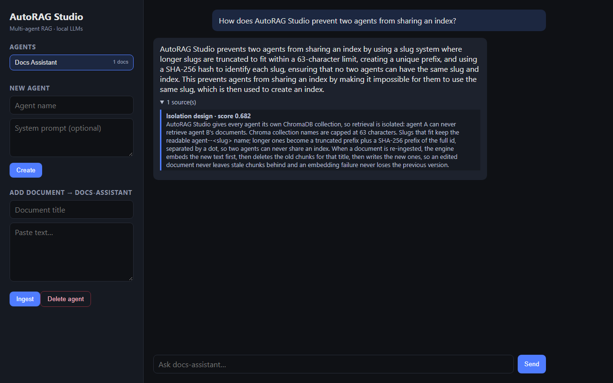

# AutoRAG Studio

[](https://github.com/tanviwadgaonkar/autoragstudio/actions/workflows/ci.yml)

A multi-agent RAG platform that runs entirely on your machine. Create agents, give each one its own documents, and chat with them — every agent retrieves only from its own isolated ChromaDB vector store, and generation runs on locally hosted LLMs through [Ollama](https://ollama.com). The chunking → embedding → retrieval pipeline is written from scratch (no LangChain), so every step is inspectable and testable.



*A real run on a laptop CPU: the agent and document were created through this UI, the Studio pushed the document to the engine, and the answer came from a local `llama3.2:1b` via Ollama, grounded in the one retrieved chunk (cosine score 0.682). The engine used `RAG_STORE=memory` because ChromaDB needs a newer VC++ runtime on that machine. A 1B model paraphrases loosely ("same slug and index"), and larger models answer more precisely.*

## Architecture

```
 React (Vite, :5173)
   │
   ├── /studio/* ──▶  Django "Studio" (:8000)         ── source of truth for
   │                  agents + documents (SQLite,        WHAT exists
   │                  admin, JSON API)
   │                        │  POST /agents/{slug}/ingest
   │                        ▼
   └── /engine/* ──▶  FastAPI "Engine" (:8001)        ── source of truth for
                      chunk → embed → store →            the VECTOR INDEX
                      retrieve → generate
                            │                │
                        ChromaDB          Ollama
                   (one collection     (embeddings +
                     per agent)         chat model)
```

The two services share nothing but the **agent slug** — the Engine keys its Chroma collections by it. That gives the platform its core guarantee: **per-agent isolation**. Agent A can never retrieve agent B's documents; the test suite proves it at the naming layer, the store layer and through the HTTP API.

### Lifecycle of a document

```
Studio: POST /api/agents/{slug}/documents/   (create or update by title)
   │  saves row (status=pending)
   ▼
Engine: POST /agents/{slug}/ingest
   1. chunk  (120-word windows, 24-word overlap)
   2. embed  (Ollama; if this fails nothing below runs → old version stays intact)
   3. delete this title's previous chunks   (an edit never leaves stale chunks)
   4. upsert new chunks into collection agent--{slug}
   │
   ▼
Studio: status=indexed  (or failed + last_error, visible in UI and admin)

Studio: DELETE /api/agents/{slug}/  →  post_delete signal → Engine DELETE /agents/{slug}/index
```

## Quickstart

### 1. Engine (FastAPI)

```bash
cd engine
pip install -r requirements.txt

# with local models (recommended):
ollama pull nomic-embed-text && ollama pull llama3.2
uvicorn app.main:app --port 8001 --reload

# or fully offline (no models; hashing embedder + echo LLM):
RAG_EMBEDDER=hash RAG_LLM=echo uvicorn app.main:app --port 8001

# no ChromaDB at all (in-process vector store, nothing persisted):
RAG_STORE=memory RAG_EMBEDDER=hash RAG_LLM=echo uvicorn app.main:app --port 8001
```

### 2. Studio (Django)

```bash
cd studio
pip install -r requirements.txt
python manage.py migrate
python manage.py createsuperuser   # optional, for /admin
python manage.py runserver 8000
```

### 3. Frontend (React)

```bash
cd frontend
npm install
npm run dev        # http://localhost:5173  (proxies to :8000 and :8001)
```

Create an agent in the sidebar, paste a document, and ask it a question — the answer comes back with the exact source chunks and similarity scores it was grounded on.

## Tests

```bash
cd engine
pip install -r requirements-dev.txt
pytest -q                      # 45 tests against in-memory ChromaDB
RAG_STORE=memory pytest -q     # same 45 tests against the dependency-free store

cd ../studio
python manage.py test          # 9 Django tests (engine calls mocked)
```

The engine suite covers **ingestion** (chunk sizing, overlap, deterministic and collision-free ids; embedding dimensionality and determinism), **re-indexing** (an edited document replaces its old chunks; a failed embedding leaves the previous version intact), **isolation** (distinct agents get distinct collection names, always valid for Chroma; agents never see each other's chunks), **persistence** (system prompts survive a restart), and **API behaviour** (404 unknown agent, 422 validation, 503 when the model backend is down). The Studio suite covers slug generation (non-Latin names, colliding names), malformed JSON, indexing status, and index cleanup on agent delete. Everything runs offline: a hashing embedder and an echo LLM stand in for Ollama. CI runs the engine suite against both store backends, the Studio suite, and a frontend build.

## Engine API

| Method | Path                        | Purpose                                  |
| ------ | --------------------------- | ---------------------------------------- |
| GET    | `/health`                   | Active embedder + LLM backends           |
| POST   | `/agents/{id}/ingest`       | Chunk + embed + index documents          |
| POST   | `/agents/{id}/query`        | Retrieval only — for debugging retrieval |
| POST   | `/agents/{id}/chat`         | Retrieve + generate; answer with sources |
| GET    | `/agents/{id}/stats`        | Indexed chunk count                      |
| DELETE | `/agents/{id}/index`        | Drop the agent's index (and its prompt)  |

Interactive docs at `http://localhost:8001/docs`.

## Design notes

**Why build the RAG layer from scratch?** To understand what the frameworks abstract. Chunking is a ~60-line sliding word window with overlap; embeddings and generation sit behind two-method interfaces with an Ollama implementation and an offline implementation each; retrieval is a cosine query against a per-agent collection. When retrieval brings back the wrong document, every knob is in this repo: chunk size, overlap, `top_k`, the embedding model, and the metadata on each chunk.

**Why a separate `/query` endpoint?** Most RAG failures are retrieval failures. `/query` shows exactly which chunks matched and at what score *before* any model touches them, which turns "the answer is wrong" into "chunk 3 outranked chunk 1, and here's why".

**Why offline test doubles?** CI should not depend on a 4 GB model download. The hashing embedder is deterministic bag-of-words — crude, but word overlap still produces meaningful cosine ordering, which is exactly enough to test the pipeline's plumbing end to end.

**Why can't two agents share a collection?** Chroma collection names are capped at 63 characters. Slugs that fit keep the readable `agent--<slug>` name; anything longer (or not already a clean slug) becomes a truncated prefix plus a SHA-256 prefix of the full id, separated by a `.` — a character slugs never contain — so a readable name can never equal a hashed one, and two hashed names collide only if 64-bit hash prefixes do (negligible, not impossible). Before this, two long agent names that shared their first 56 characters silently shared one index.

**Why delete-then-upsert on re-ingest?** Chunk ids are `<title-slug>-<title-hash>::chunk-N`. Upserting a shorter edit would overwrite chunks 0..k and leave k+1..n from the old version retrievable. The engine embeds first, then deletes the title's old chunks, then writes — so an embedding failure never loses the previous version.

**Where do system prompts live?** Next to the vector index (`<RAG_CHROMA_DIR>/system_prompts.json`, written atomically), because a restarted engine with a persistent index but an in-memory prompt would quietly answer with the default persona.

**Security model.** This is a local, single-user tool, and neither service has authentication. Don't expose them to a network as-is. The Studio JSON API skips Django's CSRF token, so to stop other websites from writing to a Studio on `localhost` it only accepts `application/json` POSTs: browsers must send a CORS preflight for those, and the server never approves one. Request sizes are bounded: 500k characters per document, 200 documents per ingest, 2,000-character questions. `DJANGO_DEBUG=0` refuses to start without a real `DJANGO_SECRET_KEY`.

**Environment variables** (engine): `RAG_STORE` = `chroma` | `memory` · `RAG_EMBEDDER` = `ollama` | `hash` · `RAG_LLM` = `ollama` | `echo` · `RAG_CHROMA` = `persistent` | `ephemeral` · `RAG_CHROMA_DIR` · `OLLAMA_URL` · `OLLAMA_EMBED_MODEL` · `OLLAMA_CHAT_MODEL` · `OLLAMA_CHAT_TIMEOUT` (s, default 120) · `OLLAMA_EMBED_TIMEOUT` (s, default 60). Studio: `ENGINE_URL`, `DJANGO_SECRET_KEY`, `DJANGO_DEBUG`.

## Project structure

```
engine/    FastAPI service + the RAG core (app/rag: chunker, embeddings, store, llm, pipeline) + 45 tests
studio/    Django backend: agent registry, document store, admin, JSON API + 11 tests
frontend/  React (Vite) UI: agent sidebar, document ingest, chat with sources
```

## Deployment

AutoRAG Studio is built to run **locally**: generation needs an Ollama server with a 1–8B model, which free hosting tiers can't run. There's no public demo. To run it on a single machine, follow *Quickstart*. Pick a chat model sized for the hardware (`llama3.2:1b` answered in about 15 s on a 4-core laptop CPU; `llama3.1` 8B took several minutes) and raise `OLLAMA_CHAT_TIMEOUT` for slow machines. A model that doesn't answer in time returns **503** with the reason, never a 500.

## Known limitations

- **Windows:** ChromaDB's native core needs a current Microsoft Visual C++ 2015–2022 Redistributable. With only the original 2015 runtime installed, `chromadb` 1.x crashes with an access violation on the first write. Install the redistributable, or use `RAG_STORE=memory`, which needs no native code.
- Ollama embeddings are requested one text at a time.
- No authentication (see *Security model*).

## Roadmap

- Tool-calling agent steps with retry/fallback on failure
- A scripted evaluation loop (fixed question set, prompt A/B comparison, accuracy + latency logging)
- File upload (PDF/DOCX) ingestion in the Studio
